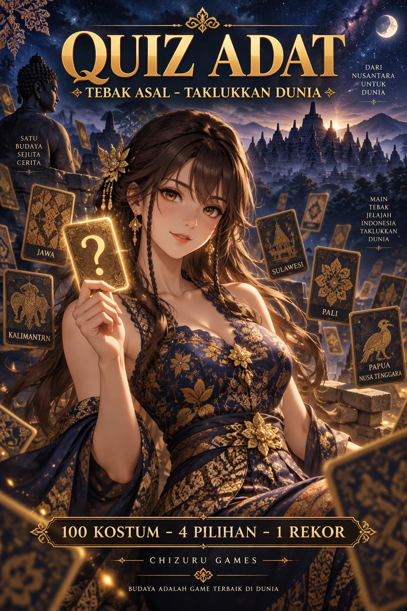

# Chizuru Quiz Adat

| Software Box | Poster |
|---|---|
|  |  |

> Promotion kit (logo, box, poster, hero, video suite) ada di folder `promo/` dan arsip `chizuru-promo-kit.zip`.

Kuis tebak daerah asal kostum Chizuru Mizuhara — 100 kostum adat Indonesia & dunia.

## Cara Main
- Diberi gambar kostum, pilih daerah asalnya dari 4 pilihan.
- Skor & streak dicatat; rekor terbaik disimpan di browser (localStorage).
- 100 soal diacak setiap sesi.

## Mainkan
https://aisac-id.github.io/chizuru-quiz-adat/

## Teknis
Static HTML + JS, tanpa server. Buka `index.html` langsung atau via GitHub Pages.
Aset gambar fan-art di folder `assets/`.