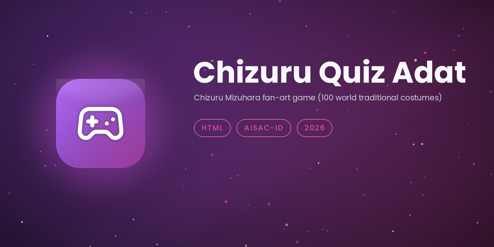

# Chizuru Quiz Adat

| Software Box | Poster |
|---|---|
|  |  |

| Social Preview | Social Square |
|---|---|
|  |  |

Kuis tebak daerah asal kostum Chizuru Mizuhara — 100 kostum adat Indonesia & dunia.

## Cara Main
- Diberi gambar kostum, pilih daerah asalnya dari 4 pilihan.
- Skor & streak dicatat; rekor terbaik disimpan di browser (localStorage).
- 100 soal diacak setiap sesi.

## Mainkan
https://aisac-id.github.io/chizuru-quiz-adat/

## Teknis
Static HTML + JS, tanpa server. Buka `index.html` langsung atau via GitHub Pages.
Aset gambar fan-art di `assets/`, brand & promotion kit di `promo/`.
Bagian dari suite **CHIZURU GAMES** (4 game, 100 kostum) — video promo suite ada di arsip promo kit.
